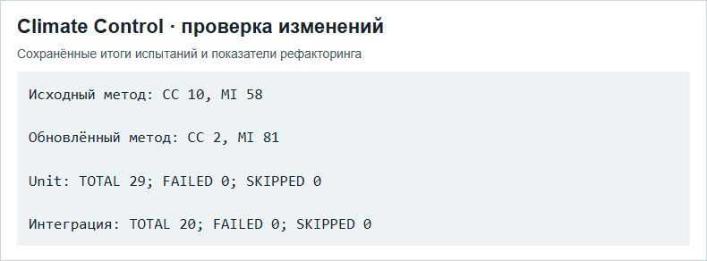

# Эссе — Модели качества ПО и адаптация legacy

МДК.03.02, вариант 3. Climate Control АИС «Умный кампус».

Пример Climate Control связывает две практики из эссе: измерение сложности при рефакторинге и проверку изменений модульными и интеграционными тестами.

## Отчёт

- [Word](../../reports/Word/Бойцов_Эссе_МДК0302.docx)
- [PDF](../../reports/PDF/Бойцов_Эссе_МДК0302.pdf)
