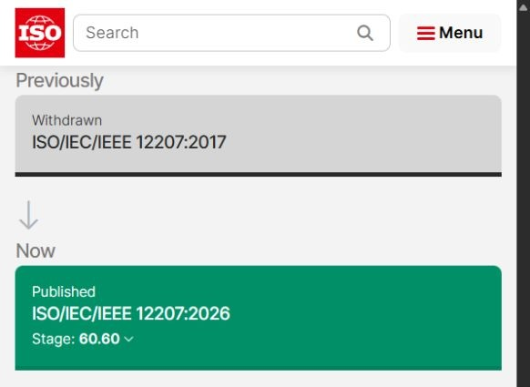

# ПР1 — Классификация стандартов

МДК.03.02, вариант 3. Объект — модуль Climate Control АИС «Умный кампус».

## Классификационная матрица

| Документ | Категория | Роль для Climate Control |
| --- | --- | --- |
| ГОСТ 19.201-78 | Документирование | Содержание ТЗ; источник идентификаторов R01–R08. |
| ГОСТ 19.301-79 | Документирование испытаний | Объект, цели, требования и методика проверки. |
| ГОСТ 34.603-92 | Процессы испытаний | Историческое учебное сравнение; утратил силу в РФ. |
| ГОСТ Р 59792-2021 | Процессы испытаний | Актуальная национальная база видов испытаний АС. |
| ГОСТ Р 56939-2024 | Безопасная разработка | Увязка анализа угроз, проверки кода и устранения дефектов. |
| ISO/IEC/IEEE 12207:2026 | Процессы жизненного цикла | Связь требований, реализации, верификации и сопровождения. |
| ISO/IEC 25010:2023 | Продукт и качество | Актуальная модель качества из девяти характеристик. |
| ISO/IEC 25010:2011 | Продукт и качество | Учебный профиль из восьми характеристик для ПР5; редакция заменена. |
| IEEE 1012-2024 | Верификация и валидация | Планирование доказательств корректности с учётом риска. |
| ISO/IEC/IEEE 29119-3:2021 | Документирование испытаний | Структура результатов, условий проверки и обнаруженных дефектов. |

## Применение в проекте

- ISO/IEC/IEEE 12207:2026 задаёт основу для связи требований, изменений и проверок.
- ISO/IEC 25010:2023 задаёт модель качества. Целостность телеметрии и отказ при недопустимом запросе проверяются на стенде.
- ГОСТ 19.201-78 использован для оформления [технического задания](../technical-specification.md). В нём закреплены [требования R01–R08](../requirements.md).

[Карточка ISO с историей редакций 12207](https://www.iso.org/standard/90219.html#lifecycle).

## Отчёт

- [Word](../../reports/Word/Бойцов_Пр1_МДК0302.docx)
- [PDF](../../reports/PDF/Бойцов_Пр1_МДК0302.pdf)

