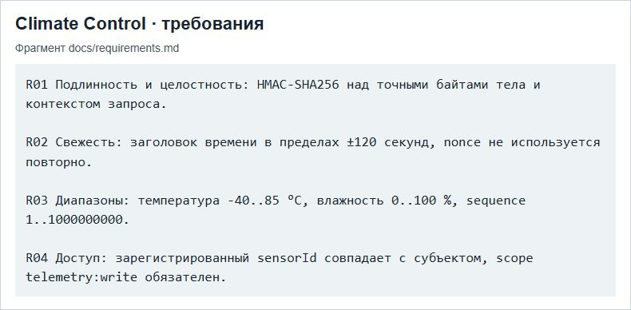

# ПР2 — Гармонизация стандартов

МДК.03.02, вариант 3. Climate Control АИС «Умный кампус».

Снимок показывает требования R01–R04. По этим обозначениям в таблице гармонизации можно проследить связь между техническим заданием и проверкой.

## Отчёт

- [Word](../../reports/Word/Бойцов_Пр2_МДК0302.docx)
- [PDF](../../reports/PDF/Бойцов_Пр2_МДК0302.pdf)
