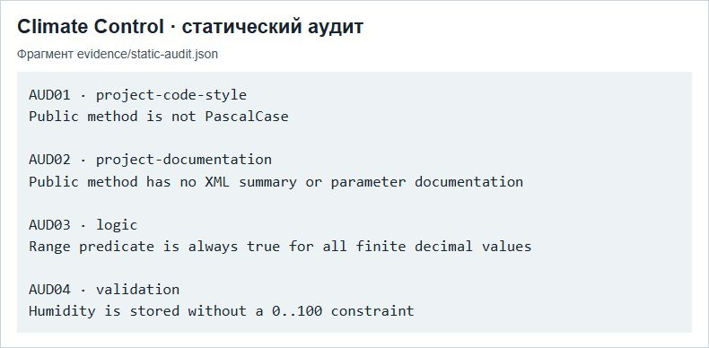

# ПР3 — Статический аудит кода

МДК.03.02, вариант 3. Climate Control АИС «Умный кампус».

На снимке приведён фрагмент журнала статического аудита. Идентификаторы AUD01–AUD04 связывают наблюдения с протоколом несоответствий в отчёте.

## Отчёт

- [Word](../../reports/Word/Бойцов_Пр3_МДК0302.docx)
- [PDF](../../reports/PDF/Бойцов_Пр3_МДК0302.pdf)
