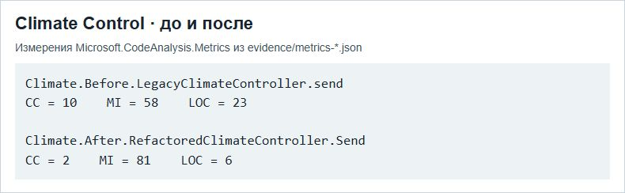

# ПР4 — Метрики и рефакторинг

МДК.03.02, вариант 3. Climate Control АИС «Умный кампус».

На снимке приведены измеренные показатели сравниваемых методов. Цикломатическая сложность снизилась с 10 до 2, индекс сопровождаемости вырос с 58 до 81.

## Отчёт

- [Word](../../reports/Word/Бойцов_Пр4_МДК0302.docx)
- [PDF](../../reports/PDF/Бойцов_Пр4_МДК0302.pdf)
