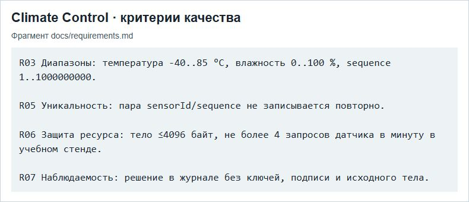

# ПР5 — Профиль качества и разбор отказа

МДК.03.02, вариант 3. Climate Control АИС «Умный кампус».

Снимок показывает критерии проверки Climate Control, относящиеся к валидации, защите ресурсов и журналированию. Эти критерии связывают профиль качества с техническим заданием.

## Отчёт

- [Word](../../reports/Word/Бойцов_Пр5_МДК0302.docx)
- [PDF](../../reports/PDF/Бойцов_Пр5_МДК0302.pdf)
