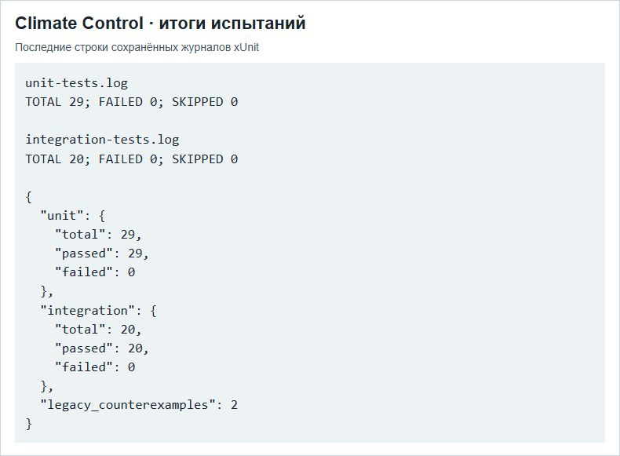

# ПР6 — Отчёт по тестированию ПО

МДК.03.02, вариант 3. Climate Control АИС «Умный кампус».

Снимок содержит итоговые строки двух сохранённых журналов. Пройдены 29 модульных и 20 интеграционных сценариев. Два модульных сценария подтверждают наличие дефекта в учебной исходной версии.

## Отчёт

- [Word](../../reports/Word/Бойцов_Пр6_МДК0302.docx)
- [PDF](../../reports/PDF/Бойцов_Пр6_МДК0302.pdf)
