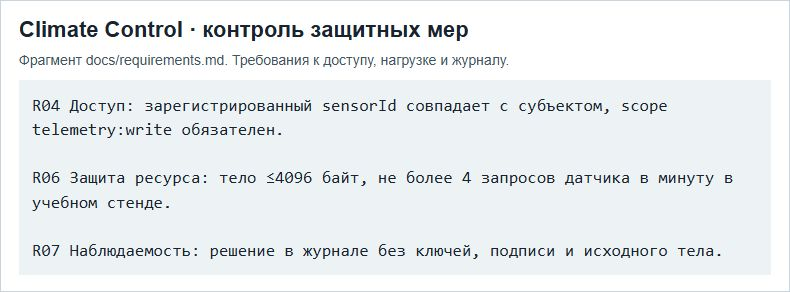

# ПР7 — Анализ угроз и уязвимостей

МДК.03.02, вариант 3. Climate Control АИС «Умный кампус».

На снимке показаны требования, по которым проверяются меры из матрицы угроз: полномочия устройства, ограничения нагрузки и состав записей журнала.

## Отчёт

- [Word](../../reports/Word/Бойцов_Пр7_МДК0302.docx)
- [PDF](../../reports/PDF/Бойцов_Пр7_МДК0302.pdf)
