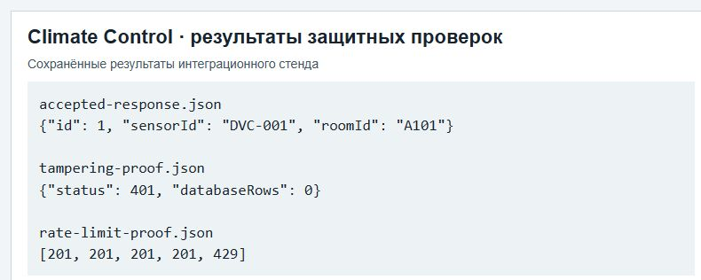

# ПР8 — Безопасная реализация приёма телеметрии

МДК.03.02, вариант 3. Climate Control АИС «Умный кампус».

На снимке сопоставлены три сохранённых результата стенда: принятие корректного сообщения, отказ при нарушении целостности и срабатывание ограничения частоты.

## Отчёт

- [Word](../../reports/Word/Бойцов_Пр8_МДК0302.docx)
- [PDF](../../reports/PDF/Бойцов_Пр8_МДК0302.pdf)
